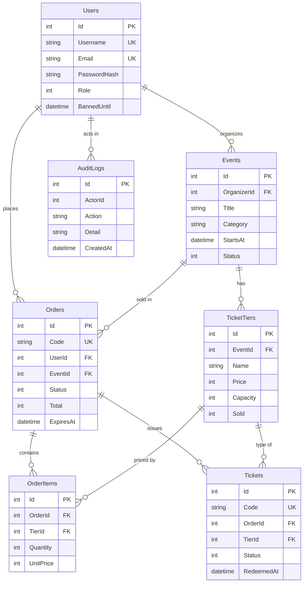

# Gişe Web

Event ticketing and AI-assisted discovery platform — SOFT3111 Internet and Web Programming, Group 13 (Işık University).

**Team:** Deniz Baran (23COMP1010) · Alper Erol (23COMP1043) · Emre Kendirci (23COMP1008)

| Deliverable | Where |
| --- | --- |
| Project #1 — Proposal | [ProjectProposal.docx](ProjectProposal.docx) |
| Project #2 — Static, navigable prototype | Repository root (`index.html` …), live on [GitHub Pages](https://denizbaran-boop.github.io/GiseWeb/) |
| **Project #3 — Functional web application** | [`src/Gise.Web`](src/Gise.Web) (ASP.NET Core MVC + EF Core + SQLite), tests in [`tests/Gise.Tests`](tests/Gise.Tests), documentation: [docs/Gise_Web_Project3_Documentation.pdf](docs/Gise_Web_Project3_Documentation.pdf) |

---

## Project #3 — Functional web application

The Project #2 screens are now a working application: server-rendered Razor views (same design and CSS as the prototype), a C# / ASP.NET Core MVC backend, a relational SQLite database through Entity Framework Core, and JavaScript that talks to a JSON API with `fetch`.

### Run it

Requirements: [.NET 10 SDK](https://dotnet.microsoft.com/download) (macOS: `brew install --cask dotnet-sdk`). Nothing else — the SQLite database file is created and filled with demo data on first start.

```bash
cd src/Gise.Web
dotnet run
# open http://localhost:5102
```

Or open `GiseWeb.slnx` in Visual Studio 2022 (17.13+), Rider or VS Code and run **Gise.Web**.
To start over with fresh demo data, stop the app and delete `src/Gise.Web/gise.db`.

**Demo accounts** (password for all: `Gise2026!`) — the sign-in page also has one-click buttons:

| Role | Login |
| --- | --- |
| Attendee | `elif.kaya@ornek.com` |
| Organizer (Sahne Kolektif) | `mert@sahnekolektif.com` |
| Admin | `zeynep@gise.app` |
| Banned attendee (to test login refusal) | `can.demir@ornek.com` |

**Test cards** (mock payment gateway, nothing is charged): `4242 4242 4242 4242` succeeds, `4000 0000 0000 0002` is declined. Any future expiry (e.g. `08/29`) and any 3-digit CVC.

### Tests

```bash
dotnet test
```

28 automated tests (xUnit): purchase and refund rules, **12 concurrent buyers competing for 5 seats never overbook**, hold expiry, forged/reused QR codes, card and form validation, and API/HTTP error responses through `WebApplicationFactory`.

### Complete workflows

| # | Workflow | Steps |
| --- | --- | --- |
| 1 | **Buy tickets** (Attendee) | Search/filter in Keşfet → event page → choose tiers → seats are **held for 10 minutes** (live countdown) → card form → payment → confirmation with one **signed QR code per ticket** → Profil → Biletlerim (show pass, print/PDF, cancel & refund until 48 h before) |
| 2 | **Publish an event** (Organizer) | Oluştur → fill the form (or *AI ile yaz* for description, rules, tags) → ticket tiers → cover (preset or upload) → Yayınla or save as draft → event is live in Keşfet → sales and revenue in Profil → Etkinliklerim |
| 3 | **Door check-in** (Organizer) | Giriş Kontrolü → pick event → type the ticket code or scan the QR with the camera → green "Giriş onaylandı" / red rejection (already used, cancelled, other event, forged) → live counter |
| 4 | **Moderation** (Admin) | Yönetim → search and filter users → ban for 7 / 30 days or permanently (with undo) → banned user is signed out immediately → unpublish events → audit log of critical actions |

Also: register / sign-in / sign-out with roles, account settings (username with live availability check, e-mail, password with strength meter), reminders toggle, light/dark mode, and the bilingual Gişe Asistan now answering from live data.

### How the requirements are met

**Interactive frontend (JavaScript)** — `wwwroot/js/`: live search and filters, ticket steppers, bottom-sheet checkout with countdown and input masks, dynamic ticket-tier rows with a live preview card, pass sheet, ban sheet with undo, camera QR scanning (`BarcodeDetector`), and the assistant. `core.js` holds the shared pieces (fetch wrapper, validator, toasts, sheets, theme).

**Backend (C# / ASP.NET Core MVC)** — `Controllers/` for pages (Razor views in `Views/`) and `Controllers/Api/` for JSON endpoints; business rules live in `Services/TicketingService.cs` (hold → pay → issue, refunds, check-in), `EventQueryService.cs` (catalog search) and `CopywriterService.cs` (AI copy). Cookie authentication with role-based authorization (`Attendee`, `Organizer`, `Admin`); passwords hashed with bcrypt (work factor 11).

**Relational database** — SQLite through EF Core 10 with migrations (`Data/Migrations`). Seven tables with foreign keys, unique indexes (username, e-mail, order and ticket codes) and a check constraint that keeps `Sold` between 0 and `Capacity`:



Seats are taken with a single conditional `UPDATE … SET Sold = Sold + n WHERE Sold + n <= Capacity` inside a transaction, so two buyers can never get the last seat. A background service releases unpaid holds after 10 minutes.

**Asynchronous communication** — every interaction after page load uses `fetch` + JSON (no full reloads):

| Method & path | Used by |
| --- | --- |
| `GET /api/events?q=&category=&sort=&maxPrice=&from=&to=` | Keşfet filters, assistant |
| `GET /api/events/{id}` | refreshing availability after a conflict |
| `POST /api/orders/hold` · `POST /api/orders/{code}/pay` · `DELETE /api/orders/{code}` | checkout |
| `POST /api/tickets/{id}/cancel` | refunds |
| `GET /bilet/goster/{id}` (HTML partial) | "Bileti Göster" sheet |
| `GET /api/account/username-available` · `PUT /api/account/{username,email,password,preferences}` | registration, settings |
| `POST /api/organizer/copy` · `POST /api/organizer/events/{id}/status` | AI copy, publish/unpublish |
| `POST /api/organizer/checkin` · `GET /api/organizer/events/{id}/checkin-stats` | door check-in |
| `GET /api/admin/users` · `POST /api/admin/users/{id}/ban` · `…/unban` | admin |

All state-changing requests carry an anti-forgery token (`X-CSRF-TOKEN` header for `fetch`, hidden field for forms).

**Input validation** — rules are written once as DataAnnotations / `IValidatableObject` on the view models (`ViewModels/ViewModels.cs`: e.g. username pattern, password strength, Luhn card check, card expiry, event at least 2 hours ahead, unique tier names, cover file type and size). ASP.NET emits them as `data-val-*` attributes and `core.js` enforces the same rules in the browser before submitting; the server re-validates everything. Business rules (sold out, 6 tickets per person, 48-hour refund window, banned accounts) are checked in the service layer. All messages are in Turkish and appear next to the field.

**Error handling** — business errors are thrown as `DomainException` and returned as RFC 7807 `application/problem+json` (400/401/403/404/409/410/402) or as a friendly page for normal requests; unexpected exceptions are logged and shown as a 500 page with a trace id (`/hata-testi` triggers one on purpose); 404/403 pages are styled; the client wrapper adds a 12-second timeout, maps field errors to inputs, and recovers from conflicts (e.g. refreshes availability after "only 2 left", resets an expired hold). The AI copywriter has a 4-second timeout and falls back to a template, so the form never blocks.

### Optional: real LLM for "AI ile yaz"

Set an Anthropic API key (kept out of the repo) and restart:

```bash
cd src/Gise.Web
dotnet user-secrets init
dotnet user-secrets set "Gise:Ai:ApiKey" "<your key>"
```

Without a key, a built-in template is used and the UI says so.

### Project structure

```
GiseWeb.slnx
src/Gise.Web/
  Controllers/         MVC pages (Home, Account, Events, Profile, Tickets, Admin, CheckIn)
  Controllers/Api/     JSON endpoints
  Data/                DbContext, migrations, demo seed
  Models/              Entities
  Services/            Ticketing, catalog search, AI copywriter, QR, auth helpers
  ViewModels/          Form/request models with validation
  Views/               Razor views and partials
  wwwroot/             app.css (prototype design), site.css, js/, img/covers/
tests/Gise.Tests/      xUnit tests
```

---

## Project #2 — Static prototype

The clickable prototype submitted for Project #2 is kept unchanged at the repository root so the GitHub Pages link keeps working. It uses HTML, CSS and vanilla JavaScript only, with state in `localStorage`.

| Page | File |
| --- | --- |
| Discover (event grid) | `index.html` |
| Sign in / Sign up | `giris.html`, `kayit.html` |
| Event detail + checkout | `etkinlik.html` |
| Ticket confirmation (QR pass) | `bilet.html` |
| Profile & my tickets | `profil.html` |
| Account settings | `ayarlar.html` |
| Create event (organizer) | `olustur.html` |
| User management (admin) | `yonetim.html` |
